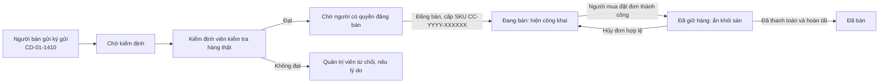
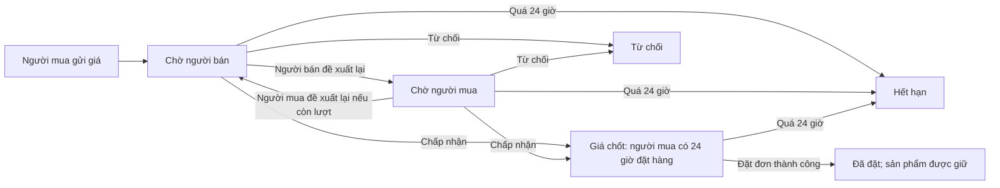

# CoCo ReTrade

Ứng dụng ký gửi và mua bán thời trang đã qua sử dụng, có kiểm định bởi CoCo. Dự án dùng .NET 10, SQL Server, ASP.NET Core Identity, EF Core, Bootstrap 5 và xUnit. Giao diện và thông báo dùng tiếng Việt; số tiền hiển thị theo dạng **10,000 VNĐ**. Mã trạng thái, tên API và tên lớp trong mã nguồn vẫn giữ nguyên để tránh thay đổi hợp đồng dữ liệu.

## Cấu trúc dự án

| Dự án | Chức năng |
|---|---|
| `src/CoCoReTrade.Domain` | Thực thể và quy tắc vòng đời sản phẩm |
| `src/CoCoReTrade.Application` | Dữ liệu trao đổi, hợp đồng dịch vụ, kiểm tra đầu vào và nghiệp vụ |
| `src/CoCoReTrade.Infrastructure` | SQL Server, tài khoản, lưu ảnh riêng tư, gửi email và dữ liệu khởi tạo |
| `src/CoCoReTrade.Web` | Giao diện MVC, Razor, khu `/Admin` và `/api/v1` |
| `tests/CoCoReTrade.Tests` | Kiểm tra quy tắc nghiệp vụ và quyền xem dữ liệu |

Hướng phụ thuộc: Application → Domain; Infrastructure → Application/Domain; Web → Application/Infrastructure.

## Giao diện CoCo

- Khách hàng: thanh điều hướng 5 mục trên điện thoại; tìm kiếm có bộ lọc mở rộng; trang sản phẩm ưu tiên mua ngay, đề xuất giá, giỏ hàng và nhắn người bán.
- Trang cá nhân nhóm riêng mua sắm, ký gửi, ví và hỗ trợ. Thông báo chưa đọc được làm nổi bật, giữ liên kết đến nội dung liên quan.
- Khu quản trị có menu riêng theo quyền: kiểm định, sản phẩm, đơn hàng, ví, báo cáo, người dùng và hỗ trợ. Trên điện thoại, bấm nút menu ở góc trái để mở.
- Phiếu kiểm định tách bước lưu kết quả và duyệt đăng bán. Ghi chú và ảnh bổ sung vẫn không bắt buộc.
- Logo SVG được dựng theo mẫu CoCo cung cấp, lưu tại `src/CoCoReTrade.Web/wwwroot/images/coco-logo.svg`; biểu tượng dùng chung ở `images/icons.svg`. Màu sắc, khoảng cách và bố cục responsive nằm trong `wwwroot/css/site.css`.
- Sau khi cập nhật giao diện, khởi động lại ứng dụng và nhấn **Ctrl + F5** nếu trình duyệt còn hiển thị bản cũ. Thay đổi giao diện này không cần migration cơ sở dữ liệu.

## Yêu cầu cài đặt

- Bộ công cụ .NET 10 (`dotnet --version`)
- Microsoft SQL Server và quyền tạo cơ sở dữ liệu `CoCoReTrade`
- Thông tin SMTP để gửi email kích hoạt/đặt lại mật khẩu ngoài môi trường phát triển

Workspace có sẵn bộ công cụ cục bộ tại `.dotnet/dotnet.exe` (Git bỏ qua). Nếu máy chưa cài .NET toàn hệ thống, dùng tệp này thay cho lệnh `dotnet`.

## Cấu hình

Chạy từ thư mục gốc của dự án:

```powershell
dotnet user-secrets set "ConnectionStrings:CoCo" "Server=localhost;Database=CoCoReTrade;Trusted_Connection=True;TrustServerCertificate=True" --project src/CoCoReTrade.Web
dotnet user-secrets set "Admin:InitialPassword" "<choose-a-strong-temporary-password>" --project src/CoCoReTrade.Web
dotnet user-secrets set "Shipping:StoreAddress" "<actual CoCo store address>" --project src/CoCoReTrade.Web
```

Bạn cũng có thể đặt `COCO_ADMIN_INITIAL_PASSWORD` trong biến môi trường. Ứng dụng chỉ cần giá trị này **khi tạo quản trị viên ban đầu**. Không đưa mật khẩu vào Git. Identity băm mật khẩu qua `UserManager`; quản trị viên phải đổi mật khẩu sau lần đăng nhập đầu.

Tài khoản quản trị mặc định là `admin@cocoretrade.vn` / `0905123456`. Tài khoản được tạo ở lần chạy đầu sau khi cập nhật cơ sở dữ liệu. Mật khẩu không nằm trong mã nguồn hoặc tệp migration.

Quản trị viên thứ hai tùy chọn có tên `admin1`, đăng nhập bằng `admin1@cocoretrade.vn`. Để tạo trên cơ sở dữ liệu khác, đặt `COCO_ADMIN1_INITIAL_PASSWORD` trước lần khởi động đầu rồi xóa biến môi trường. Hệ thống băm mật khẩu qua Identity, cấp vai trò cần thiết và yêu cầu đổi mật khẩu ở lần đăng nhập đầu. Tài khoản thường đã dùng email này sẽ không được tự nâng quyền.

Khi triển khai, đặt `Storage:Root`, `Smtp:Host`, `Smtp:Port`, `Smtp:From`, `Smtp:User` và `Smtp:Password` bằng biến môi trường hoặc kho bí mật; xem `appsettings.example.json`. Trong môi trường phát triển, mã kích hoạt và đặt lại mật khẩu gồm 6 số được hiển thị ở trang xác nhận và ghi log. Môi trường khác cần SMTP. Không bật hiển thị mã thử nghiệm khi vận hành thật.

## Khôi phục gói, cập nhật cơ sở dữ liệu và chạy ứng dụng

Để xem giao diện trước khi cài SQL Server, chạy lệnh sau trong PowerShell. Chế độ này chỉ dùng cho môi trường phát triển, hiển thị sáu sản phẩm minh họa và không ghi dữ liệu. Đăng nhập, đăng ký, ký gửi và đặt hàng cần SQL Server nên không hoạt động trong chế độ xem thử.

```powershell
$env:Preview__Enabled = "true"
dotnet run --project src/CoCoReTrade.Web --launch-profile http
```

Mở `http://localhost:5001/preview` để xem các màn hình. Xóa biến bằng `Remove-Item Env:Preview__Enabled` trước khi chạy với SQL Server.

```powershell
dotnet restore CoCoReTrade.slnx
dotnet tool restore
dotnet tool run dotnet-ef database update --project src/CoCoReTrade.Infrastructure --startup-project src/CoCoReTrade.Web
dotnet run --project src/CoCoReTrade.Web
```

Ứng dụng cũng tự áp dụng migration còn thiếu khi khởi động. Để tạo migration mới:

```powershell
dotnet tool run dotnet-ef migrations add NameOfChange --project src/CoCoReTrade.Infrastructure --startup-project src/CoCoReTrade.Web --output-dir Migrations
dotnet tool run dotnet-ef database update --project src/CoCoReTrade.Infrastructure --startup-project src/CoCoReTrade.Web
```

Các migration đã nằm trong mã nguồn. Dãy `dbo.ProductSkuSequence` của SQL Server cấp mã chờ duyệt (`CD-01-1410`) khi người bán gửi bài và SKU chính thức (`CC-YYYY-XXXXXX`) khi quản trị viên đăng bán. Chỉ SKU chính thức được in lên tem sản phẩm và dùng để tìm món đã đăng bán. Mỗi mã có chỉ mục duy nhất. Số tiền VNĐ dùng `decimal(18,0)`. Bản ghi sản phẩm, trả giá, đơn hàng và ví có cột phiên bản dòng của SQL Server.

Nếu EF báo lỗi kết nối hoặc chứng chỉ, hãy đối chiếu giá trị `Server=` trong `ConnectionStrings:CoCo` với **Server Name** của kết nối SSMS đang dùng. Bộ tạo DbContext khi thiết kế đọc user secrets của Web và `ConnectionStrings__CoCo`; không cần ghi mật khẩu vào mã nguồn. Kiểm tra dịch vụ SQL Server và thiết lập TLS/chứng chỉ trước khi áp dụng migration. Kết nối thất bại sẽ không cập nhật cơ sở dữ liệu.

## Luồng hoạt động của ứng dụng

Phần này mô tả **những gì mã nguồn hiện tại xử lý**, theo thứ tự người dùng thao tác. Một tài khoản có thể đồng thời mua và bán; kiểm định viên và quản trị viên vẫn dùng được các chức năng của người dùng. Các thao tác cần dữ liệu thật chạy với SQL Server; chế độ xem thử chỉ để xem giao diện.

### Sơ đồ vòng đời chính



Việc **chấp nhận giá đề xuất không giữ sản phẩm**. Chỉ thao tác tạo đơn thành công mới giữ món hàng độc bản.

### 1. Mở ứng dụng, tài khoản và phân quyền

1. Trang `/Splash` hiển thị khung chờ khi tải, kiểm tra phiên Identity và chuyển người đã đăng nhập tới Trang chủ, khách chưa đăng nhập tới Đăng nhập. Trang chủ và Khám phá vẫn có thể được mở trực tiếp để xem hàng `ACTIVE`.
2. Đăng ký bằng họ tên, email, số điện thoại duy nhất và mật khẩu hợp lệ. Hệ thống gửi **mã xác thực 6 số qua email** để kích hoạt; mã có hiệu lực 5 phút và có luồng gửi lại. Trong môi trường phát triển, mã hiện trên trang xác nhận để thử nghiệm; môi trường khác cần cấu hình SMTP.
3. Đăng nhập chung bằng **email hoặc số điện thoại + mật khẩu**. Identity kiểm tra tài khoản đã kích hoạt, trạng thái khóa và chính sách điểm tín nhiệm. Quên mật khẩu: nhập email/số điện thoại → nhận OTP email → xác minh → đặt mật khẩu mới → thu hồi phiên cũ và tạo phiên đăng nhập mới. Tài khoản có thể đổi mật khẩu và đăng xuất tại Hồ sơ.
4. Vai trò `User` mua/bán; `Inspector` được xem và kiểm định hàng chờ duyệt; `Admin` quản trị đầy đủ. Quyền `Products.Publish` là quyền riêng: quản trị viên có sẵn, kiểm định viên chỉ có khi được cấp rõ ràng. Thay đổi vai trò/quyền sẽ làm phiên cũ mất hiệu lực. Quản trị viên khởi tạo từ cấu hình phải đổi mật khẩu sau lần đăng nhập đầu.
5. Tài khoản bị hạ điểm tín nhiệm dưới ngưỡng cấu hình có thể bị tạm khóa; quản trị viên thay đổi điểm hoặc khóa tài khoản phải ghi lý do và lưu nhật ký.

### 2. Điều hướng và khám phá sản phẩm

- Giao diện tương thích di động có **5 mục điều hướng dưới màn hình**: Trang chủ, Khám phá, Đăng bán, Thông báo, Tôi. Mục Kiểm định/Quản trị chỉ hiển thị cho nhân viên có quyền tương ứng.
- Trang chủ hiển thị sản phẩm đang bán và danh mục nhanh. Khám phá cho tìm tên, thương hiệu, mã sản phẩm; lọc danh mục, thương hiệu, kích cỡ, khoảng giá, độ mới và hình thức nhận; sắp xếp mới nhất, giá tăng/giảm hoặc được thích nhiều.
- Thẻ và trang chi tiết hiển thị ảnh, tình trạng đã kiểm định, giá, người bán, nút thích, trả giá hoặc mua. **Truy vấn công khai và ảnh công khai chỉ trả sản phẩm `ACTIVE`**; người khác không thể mở hàng chờ duyệt hoặc bị từ chối bằng URL.
- Người dùng có thể thích/bỏ thích hàng `ACTIVE`, theo dõi người bán, xem danh sách đã lưu và tủ đồ công khai của người bán. Các thao tác giỏ hàng, trả giá và nhắn người bán được mô tả riêng ở mục 4–6.

### 3. Ký gửi và kiểm định

1. Người bán mở **Đăng bán**, nhập tên, thương hiệu, danh mục, kích cỡ, giá gốc, giá mong muốn, phần trăm độ mới và bật/tắt `AllowOffers`. Tải **3–10 ảnh JPG/PNG/WebP**, tối đa 5 MB mỗi ảnh. Ảnh được kiểm tra định dạng, kích thước, số lượng và lưu ở vùng riêng.
2. Bấm gửi duyệt: hệ thống cấp **mã chờ duyệt** dạng `CD-01-1410`, lưu sản phẩm `PENDING_APPROVAL` và báo nhân viên. Người bán theo dõi mã này trong **Tủ đồ của tôi**.
3. Kiểm định viên tra cứu danh sách chờ bằng mã chờ duyệt/tên món/người bán, nhận món đồ thật, ghi kết quả đạt/không đạt, thông tin xác minh (tên, thương hiệu, loại, kích cỡ, giá, độ mới), ghi chú và ảnh kiểm định tùy chọn. Kiểm định viên không được tự kiểm định bài do mình đăng. Kiểm định đạt giúp bài đủ điều kiện đăng bán nhưng chưa tạo SKU.
4. Người có `Products.Publish` kiểm tra lại và bấm **Duyệt & Đăng bán**. Trong cùng thao tác, hệ thống cấp SKU chính thức `CC-YYYY-XXXXXX` duy nhất và chuyển sản phẩm sang `ACTIVE`; SKU xuất hiện trên trang chi tiết, dùng để tìm kiếm và in tem QR dán lên món hàng. Quản trị viên có thể **Từ chối** bài đã kiểm định với lý do bắt buộc, chuyển sang `REJECTED`. Hai kết quả đều báo người bán; kiểm định, đăng bán và từ chối đều được ghi nhật ký.
5. Tủ đồ cá nhân cho người bán xem hàng chờ duyệt, bị từ chối, đang bán và đã bán. Trạng thái chờ/từ chối và ảnh liên quan chỉ mở cho chủ bài hoặc nhân viên có quyền.

### 4. Trả giá và đề xuất lại

**Điểm bắt đầu:** Người mua đã đăng nhập mở trang chi tiết món `ACTIVE` có `AllowOffers = true`, bấm **Trả giá**. Người bán không thể trả giá món của mình. Trang tạo đề xuất cho thấy giá niêm yết và giá tối thiểu; các điều kiện được kiểm tra lại ở dịch vụ khi gửi, không dựa vào ô nhập trên trình duyệt.

1. **Người mua gửi giá lần đầu:** giá phải là số VNĐ nguyên, thấp hơn giá niêm yết và không dưới mức `ceil(giá niêm yết × (1 − mức giảm tối đa))`. Mặc định mức giảm tối đa 25%; ví dụ món 300,000 VNĐ nhận giá từ **225,000 VNĐ đến 299,999 VNĐ**. Cấu hình mức giảm chỉ nhận 20–30%.
2. Hệ thống lưu đề xuất `PendingSeller`, ghi sự kiện `Submitted`, đặt hạn phản hồi sau **24 giờ** và thông báo người bán. Người mua và người bán theo dõi các đề xuất mình tham gia tại **Hồ sơ → Đề xuất giá** hoặc `/Offers`; người ngoài không xem được chi tiết.
3. **Đến lượt người bán:** người bán chọn **Chấp nhận** để chốt giá người mua đưa ra, **Từ chối** để kết thúc, hoặc **Đề xuất lại** một giá cao hơn giá người mua gần nhất và không vượt giá niêm yết. Nếu người bán đã đề xuất lại trước đó, lần sau phải thấp hơn giá của mình lần trước. Hệ thống đổi trạng thái sang `PendingBuyer`, ghi sự kiện và thông báo người mua.
4. **Đến lượt người mua sau khi người bán đề xuất lại:** người mua **Chấp nhận** giá người bán, **Từ chối**, hoặc **đề xuất lại** giá cao hơn lần mình trả trước, thấp hơn giá người bán gần nhất và không dưới giá tối thiểu. Ví dụ: người mua 230,000 VNĐ → người bán 260,000 VNĐ → người mua 245,000 VNĐ. Mỗi giá người mua gửi, kể cả đề xuất lại, tiêu tốn **1 trong tối đa 3 lượt trên cùng sản phẩm**. Hết lượt vẫn có thể chấp nhận hoặc từ chối giá người bán.
5. Mỗi lần đề xuất lại đặt lại hạn phản hồi **24 giờ**; lúc một bên chấp nhận, trạng thái thành `Accepted` và giá chốt chỉ dành cho đúng người mua này trong **24 giờ tính từ lúc chấp nhận**. Chấp nhận giá **chưa giữ sản phẩm**. Người mua chọn **Tới CoCo lấy trong 24 giờ** hoặc **Giao hàng tận nơi** ở trang chi tiết đề xuất; cả hai đưa `offerId` vào màn đặt hàng. Với lựa chọn tới CoCo, người mua hẹn giờ và **xác nhận đơn** thì CoCo mới tạm giữ món đồ. Dùng liên kết **Mua ngay** hoặc **Đặt mua** ở giỏ sẽ áp dụng giá niêm yết.
6. Dịch vụ từ chối phản hồi/đặt hàng khi đề xuất quá hạn, sai lượt, sai chủ thể hoặc món không còn `ACTIVE`. Đề xuất hết hạn thành `Expired`; đề xuất được dùng để tạo đơn thành `Used`. Lịch sử `OfferEvents` lưu mọi lần gửi giá, đề xuất lại, chấp nhận, từ chối, hết hạn và dùng để đặt đơn. Bên kia nhận thông báo trong ứng dụng sau mỗi phản hồi.



### 5. Giỏ hàng

1. Người mua đã đăng nhập mở món `ACTIVE` không thuộc mình, bấm **Thêm vào giỏ** ở trang chi tiết. Hệ thống kiểm tra lại trạng thái và chủ hàng. Cùng một món chỉ xuất hiện **một lần** trong giỏ của tài khoản; tối đa **20 món**.
2. Mở biểu tượng **Giỏ hàng** trên đầu trang hoặc `/Cart` để xem ảnh, mã sản phẩm, tên, kích cỡ, tình trạng và **giá niêm yết hiện tại**. Tại đây người mua có thể **Bỏ khỏi giỏ** hoặc **Đặt mua** từng món. Thêm giỏ không tạo đơn, không khóa hàng và không đảm bảo món vẫn còn khi quay lại.
3. Bấm **Đặt mua** chuyển đến đặt hàng của **một món**; máy chủ tính lại giá và phí. Nếu món đã bị giữ/bán hoặc ngừng `ACTIVE`, giỏ sẽ loại món không còn mở bán khi tải lại. Một món có thể bị người khác mua trước lúc người mua xác nhận đơn; đặt hàng xử lý tranh chấp này bằng giao dịch và ràng buộc dữ liệu.
4. **Chưa có đặt hàng nhiều món trong một lần**, chưa có số lượng cho sản phẩm độc bản và giỏ không tự áp dụng giá đã thỏa thuận. Để mua theo giá thương lượng, người mua phải mở đề xuất `Accepted` của mình rồi vào đặt hàng từ đó.

### 6. Nhắn người bán

1. Người mua đã đăng nhập mở chi tiết món `ACTIVE` của người khác, bấm **Nhắn người bán**. Hệ thống tìm hội thoại theo **cặp sản phẩm + người mua**; nếu chưa có thì tạo một hội thoại riêng với người bán, nếu đã có thì mở lại hội thoại đó. Bấm nút chỉ **mở hội thoại trống**, chưa tự gửi lời nhắn.
2. Người mua nhập nội dung và bấm **Gửi tin nhắn**. Người bán mở biểu tượng **Tin nhắn** trên đầu trang hoặc mục Tin nhắn trong Hồ sơ để xem danh sách và trả lời. Hai bên có thể tiếp tục nói chuyện trong hội thoại đã tạo, kể cả sau khi sản phẩm không còn mở bán.
3. Nội dung sau khi cắt khoảng trắng phải dài **1–1,000 ký tự**; cùng một người cần chờ ít nhất **3 giây** giữa hai tin liên tiếp. Mỗi tin được lưu SQL Server, cập nhật thời gian hoạt động của hội thoại và tạo thông báo cho người còn lại. Danh sách hiện tối đa 100 hội thoại gần nhất; trang chi tiết hiện 200 tin gần nhất và đánh dấu tin nhận đã đọc.
4. Chỉ đúng người mua và người bán của hội thoại được xem/gửi; người khác không thể đọc bằng URL/API hoặc tự tham gia nhóm SignalR. Sau khi giao dịch SQL lưu tin thành công, SignalR đẩy tin tới hai trình duyệt đang mở hội thoại. JavaScript gửi tin qua API có mã chống giả mạo, thêm tin mới ngay vào trang và lọc trùng theo mã tin. Khi kết nối lại, trình duyệt tải tin từ SQL Server để bù tin đã bỏ lỡ; nếu JavaScript không chạy, biểu mẫu POST thông thường vẫn gửi được.
5. SignalR hiện cập nhật **trang chi tiết hội thoại** theo thời gian thực; danh sách hội thoại và biểu tượng thông báo chưa cập nhật tức thời. Tin vẫn được lưu và thông báo trong ứng dụng cho người không mở trang chat. Chưa có SMS; nút trả giá là luồng riêng, không tự tạo đề xuất giá từ nội dung chat. Bản cài đặt một web server không cần dịch vụ SignalR ngoài; triển khai nhiều server cần cấu hình scale-out như Redis backplane hoặc Azure SignalR Service.

### 7. Đặt hàng, giao nhận và quản lý đơn

1. Người mua chọn **Mua ngay** ở giá niêm yết hoặc thanh toán bằng **đề xuất giá của chính mình đã được chấp nhận và còn hạn**. Không thể mua món của mình, món chưa đăng bán hay món đã giữ/bán. Máy chủ tính báo giá; trình duyệt không được quyết định giá, phí hoặc chủ hàng.
2. Chọn **Tới CoCo lấy**: nhập tên, số di động Việt Nam và lịch lấy trong giờ mở cửa cấu hình (mặc định 09:00–21:00). Với **mua ngay**, lịch lấy trong **1–3 ngày tới**. Với **giá đã chấp nhận**, lịch lấy có thể là hôm nay nhưng phải trong **24 giờ kể từ lúc chấp nhận giá**; máy chủ kiểm tra giờ lấy trước hạn giá thỏa thuận. Phí nhận tại cửa hàng **0 VNĐ**; chức năng chỉ mở khi cấu hình địa chỉ cửa hàng thật.
3. Chọn **Giao tận nơi**: nhập tên, số điện thoại, **tỉnh/thành phố + phường/xã + địa chỉ cụ thể**, chọn khung giao và ghi chú nếu cần; có thể chọn địa chỉ đã lưu. Ứng dụng không dựa vào danh sách quận/huyện cũ. Bảng `ShippingZones` xác định cặp tỉnh/phường nội thành: phí **20,000 VNĐ**; địa chỉ hợp lệ khác **35,000 VNĐ**. Phí hiển thị khi chọn đủ vùng.
4. Màn đặt hàng hiển thị **tiền hàng + phí vận chuyển = tổng thanh toán** theo kết quả máy chủ. Nếu chưa chọn đủ địa chỉ giao, phí còn chờ tính. Khách **không chuyển khoản trước**; giao tận nơi thì kiểm tra hàng rồi trả tiền mặt cho người giao hàng nếu nhận, tới CoCo lấy thì kiểm tra và trả tiền mặt tại cửa hàng. Hoa hồng CoCo mặc định **15%**, được cấu hình trong khoảng **15–20%**, tính trên **giá hàng cuối cùng**, không tính phí giao hàng.
   Chính sách dự kiến: khách từ chối nhận khi người giao hàng đến chịu phí vận chuyển một chiều; sau khi đã thanh toán cho người giao hàng thì không nhận yêu cầu hoàn trả vì đổi ý. Ứng dụng hiện **chưa có luồng thu riêng phí một chiều hoặc xử lý yêu cầu trả hàng**; các nội dung này cần được CoCo duyệt thành điều khoản chính thức trước khi áp dụng.
5. Xác nhận: giao dịch SQL tạo một đơn `PENDING_PROCESSING`, trạng thái thanh toán `UNPAID`, rồi chuyển sản phẩm `ACTIVE → RESERVED`. Với đơn hẹn lấy tại CoCo, đó là lúc món đồ bắt đầu được tạm giữ, ẩn khỏi cửa hàng/tìm kiếm và xuất hiện tại **Quản trị → Tạm giữ chờ lấy** (`/Admin/Orders/HeldPickups`) cùng giờ hẹn, người nhận và hạn giá thỏa thuận. Đơn lưu bản chụp bất biến của món hàng, giá chốt, hoa hồng, phí giao hàng, người nhận, địa chỉ hoặc lịch lấy. Phiên bản dòng, ràng buộc một đơn còn hiệu lực cho một món và mã yêu cầu duy nhất chống mua trùng/gửi lại. Quản trị viên, người bán và người mua được báo. Người bán xem đơn mà không thấy địa chỉ/liên hệ riêng của người mua.

### 8. Xử lý, hủy và hoàn tất đơn

- Người mua xem lịch sử/trạng thái đơn. Người mua chỉ được hủy đơn **chưa thanh toán và còn `PENDING_PROCESSING`**; quản trị viên có thể hủy thêm đơn pickup `READY_FOR_PICKUP` chưa thanh toán. Với đơn đã giao cho người giao hàng nhưng khách từ chối nhận, quản trị viên chỉ được ghi nhận không nhận hàng và mở bán lại **sau khi xác nhận món đồ thực tế đã quay về CoCo**; thao tác này chỉ áp dụng cho đơn `UNPAID` đang `SHIPPING`. Hủy hợp lệ chuyển đơn sang `CANCELLED`, trả sản phẩm `RESERVED → ACTIVE` và thông báo các bên.
- Quản trị viên xem hàng đợi đơn, đánh dấu **sẵn sàng nhận tại cửa hàng** hoặc **đang giao**. Chỉ sau khi khách thực sự nhận hàng và CoCo xác nhận đã thu tiền, nhân viên nhập mã tham chiếu thanh toán rồi bấm **Giao hàng thành công / Khách đã nhận tại CoCo**. Xác nhận thanh toán chỉ khả dụng sau khi đơn đã sẵn sàng hoặc đang giao. Hoàn tất chuyển đơn `COMPLETED`, sản phẩm `SOLD` và ghi có ví người bán trong cùng giao dịch SQL.
- Tác vụ nền hết hạn tự hủy và mở bán lại **đơn vẫn chưa thanh toán, vẫn chờ xử lý** quá `Orders:UnpaidReservationMinutes` (mặc định 1,440 phút). Với đơn **giá thỏa thuận, nhận tại CoCo**, nếu quá 24 giờ tính từ lúc chấp nhận giá mà vẫn chưa nhận/chưa thanh toán, tác vụ nền hủy cả đơn đang chờ xử lý hoặc đã sẵn sàng tại cửa hàng, mở bán lại sản phẩm theo giá niêm yết. Đề xuất giá đã dùng không thể áp dụng lần nữa. Đơn **giao tận nơi theo giá thỏa thuận** chỉ cần được tạo trước khi giá hết hạn, không bị hủy theo quy tắc nhận tại CoCo trong 24 giờ. Tạo đơn hoặc đánh dấu đang giao **không đồng nghĩa đã nhận tiền**.

### 9. Ví ký gửi và rút tiền

1. Khi nhân viên đánh dấu đơn **đã giao/nhận thành công** sau khi xác nhận đã thu tiền, hệ thống ghi có **một lần, cùng giao dịch với việc hoàn tất đơn** vào ví người bán: `giá hàng chốt − hoa hồng CoCo`; tiền giao hàng không tham gia phép tính. Đồng thời ghi hoa hồng của đơn vào **Ví hoa hồng CoCo** (`/Admin/Wallets/Platform`), sổ chung của sàn tách khỏi ví ký gửi cá nhân của từng admin. Mỗi đơn có tối đa một bút toán hoa hồng; migration điền bút toán cho đơn cũ đã thanh toán và hoàn tất. Đặt đơn hoặc chỉ xác nhận thanh toán **không ghi có ví**. Màn hình đối soát ví vẫn có thao tác ghi có thủ công cho **đơn cũ đã hoàn tất trước khi triển khai tính năng này**. Ví CoCo hiện theo dõi doanh thu hoa hồng; hệ thống chưa ghi nhận việc chuyển tiền mặt thực tế vào tài khoản ngân hàng của sàn.
2. Người bán xem số dư khả dụng, tiền đang chờ rút và lịch sử giao dịch; gửi yêu cầu với **số tài khoản đầy đủ gồm 6–30 chữ số** và **tên ngân hàng**. Hệ thống giữ tiền khỏi số dư khả dụng ngay khi tạo yêu cầu và dùng mã yêu cầu để chống gửi lặp. Số tài khoản được lưu dạng chuỗi để giữ số 0 ở đầu; người bán và quản trị viên có quyền quản lý ví nhìn thấy đầy đủ trong lịch sử/yêu cầu.
3. Quản trị viên **duyệt** yêu cầu, sau đó tự thực hiện chuyển khoản bên ngoài ứng dụng. Chỉ khi đã kiểm tra giao dịch thực tế, quản trị viên nhập **mã giao dịch ngân hàng** và bấm **Xác nhận đã chuyển tiền**. Lúc đó yêu cầu thành `Transferred`, lưu nhân viên/thời gian/mã giao dịch, ghi nhật ký và thông báo người bán. Bước xác nhận này **không trừ ví lần thứ hai**; số tiền đã được giữ từ lúc yêu cầu. Thao tác lặp với cùng mã giao dịch không tạo thêm bản ghi quyết toán.
4. Quản trị viên có thể **từ chối yêu cầu `Pending` hoặc `Approved` chưa chuyển**, nêu lý do và hoàn đúng số tiền đã giữ về số dư khả dụng. Yêu cầu cũ chỉ lưu tài khoản đã che không thể chuyển; quản trị viên từ chối để người bán gửi lại với đầy đủ thông tin. Ứng dụng **không kết nối API ngân hàng**, trạng thái `Transferred` là xác nhận thủ công của nhân viên sau khi đối chiếu giao dịch thật.

### 10. Thông báo, hồ sơ, hỗ trợ và quản trị

- Hộp thông báo trong ứng dụng chia **Giao dịch & đề xuất giá / Sản phẩm / Tương tác & hệ thống**, hỗ trợ đánh dấu đã đọc. Các sự kiện ký gửi, kiểm định, đơn, trả giá, tin nhắn, ví và hỗ trợ tạo thông báo phù hợp. Thông báo và hàng đợi gửi email/web push được lưu giao dịch; tác vụ nền thử gửi lại theo lịch. Email chỉ gửi được khi cấu hình SMTP; chưa có nhà cung cấp web push thật.
- Hồ sơ cho đổi ảnh đại diện, xem điểm tín nhiệm, tủ đồ, đề xuất giá, đơn mua/bán, hàng đã lưu, địa chỉ, ví, thông báo, tin nhắn, giỏ hàng, đổi mật khẩu, trợ giúp và đăng xuất. Trang điều khoản hiện là nội dung vận hành; văn bản pháp lý chính thức cần được phê duyệt riêng.
- Người dùng tạo yêu cầu hỗ trợ và trả lời yêu cầu của mình. Quản trị viên có quyền quản lý người dùng xem hàng đợi, trả lời và đóng yêu cầu hỗ trợ; phản hồi gửi thông báo, thao tác quản trị ghi nhật ký.
- Khu `/Admin` có bảng điều khiển, danh sách ký gửi, kiểm định, quản lý sản phẩm/đơn/ví/người dùng, phân quyền kiểm định viên và `Products.Publish`, điểm tín nhiệm, hộp hỗ trợ và nhật ký hoạt động. Chính sách quyền được kiểm tra ở MVC/API **và dịch vụ**, không chỉ ẩn nút giao diện. Nhân viên không tự động đăng bán khi kiểm định đạt.

### 11. Dịch vụ nền và giới hạn tích hợp

| Dịch vụ | Công việc hiện tại |
|---|---|
| ProductCode/Lifecycle | Cấp mã bằng SQL sequence, kiểm tra chuyển trạng thái hợp lệ, giữ/bán/mở lại hàng |
| OfferExpirationWorker | Hết hạn đề xuất giá cũ khoảng mỗi phút |
| OrderExpirationWorker | Hủy đơn chưa thanh toán còn chờ quá thời hạn khoảng mỗi phút |
| ListingReminderWorker | Nhắc người bán một lần khi bài `ACTIVE` cũ quá `Listings:ReminderAfterDays` (mặc định 30 ngày); không tự hạ giá |
| OutboxDispatcherWorker | Xử lý hàng đợi email/web push khoảng mỗi 15 giây; có retry, gửi có thể lặp nên nhà cung cấp phải chống trùng |

Mọi mốc thời gian được lưu UTC. Các thay đổi quan trọng dùng giao dịch và phiên bản dòng. **Không tác vụ nền nào tự đăng bán sản phẩm.** Hiện chưa có địa chỉ cửa hàng thật, tài khoản dịch vụ SMS OTP, Google/Apple, web push, cổng thanh toán hay chuyển khoản ngân hàng. Cấu hình SMTP là điều kiện để OTP email chạy ngoài Development. Những tích hợp này không được xem là đã hoàn thành chỉ vì đã có màn hình, trạng thái hoặc thông báo nội bộ.

### Cấu hình liên quan đến các luồng

- `Marketplace:MaximumOfferDiscountPercent` mặc định `25`, chỉ nhận `20–30`; `Marketplace:CommissionPercent` mặc định `15`, chỉ nhận `15–20`. Cấu hình ngoài khoảng hợp lệ sẽ khiến ứng dụng không khởi động.
- `Shipping:InnerCityZones` chứa **cặp tỉnh/thành và phường/xã hiện hành**, ví dụ `[{ "Province": "<tỉnh/thành>", "Ward": "<phường/xã>" }]`. Dữ liệu này chỉ được seed vào bảng `ShippingZones` khi bảng trống. Sau đó quản lý các cột `Province`, `Ward`, `IsInnerCity`, `IsActive` trong SQL Server. Không tự suy đoán quận/huyện cũ là phường/xã mới.
- Pickup cần `Shipping:StoreAddress` thật. `Shipping:StoreUtcOffsetHours`, `Shipping:OpeningHour`, `Shipping:ClosingHour` điều khiển lịch lấy; `Shipping:StoreMapUrl` là liên kết bản đồ HTTPS tùy chọn. `Orders:UnpaidReservationMinutes` mặc định `1440` (cho phép `15–10080`); `Listings:ReminderAfterDays` mặc định `30` (cho phép `7–365`).
- Nếu nâng cấp database đã có dữ liệu, hãy sao lưu trước khi áp dụng migrations. `InspectorWorkflow` chuyển mã sản phẩm cũ của bài ký gửi thành mã ký gửi; `CheckoutOrders` giữ địa chỉ cũ trong `StreetAddress` và không tự biến quận/huyện thành phường/xã. `SkuGeneratedOnPublish` xóa SKU tạm đã cấp cho bài còn chờ hoặc bị từ chối; các món đã đăng bán/đặt/bán giữ nguyên SKU chính thức. Migration rút tiền `WithdrawalTransferConfirmation` thêm số tài khoản đầy đủ, tên ngân hàng, mã/thời gian/người xác nhận chuyển khoản và phiên bản dòng; không thể khôi phục số tài khoản đầy đủ từ yêu cầu cũ đã che.
- Chat thời gian thực dùng JavaScript trình duyệt `@microsoft/signalr` 10.0.0 lưu tại `src/CoCoReTrade.Web/wwwroot/lib/signalr` cùng giấy phép MIT. Hub chạy tại `/hubs/conversations`; không cần migration mới hay npm khi chạy ứng dụng.

## API phiên bản 1

Đường dẫn và tên trường JSON là hợp đồng kỹ thuật nên giữ nguyên; phần mô tả dưới đây dùng tiếng Việt.

- `GET /api/v1/products`, `GET /api/v1/products/{id}` — chỉ trả sản phẩm đang mở bán.
- `GET /api/v1/listings/mine`, `POST /api/v1/listings` — bài ký gửi của người đã đăng nhập.
- `GET /api/v1/admin/inspections/pending`, `GET /api/v1/admin/inspections/{id}`, `POST /api/v1/admin/inspections/{id}` — xem và ghi kết quả kiểm định theo quyền; yêu cầu ghi kết quả dùng biểu mẫu nhiều phần, gồm phiên bản dòng và ảnh tùy chọn.
- `POST /api/v1/admin/inspections/{id}/publish`, `POST .../{id}/reject` — đăng bán cần quyền `Products.Publish`; từ chối cần quyền quản trị.
- `GET /api/v1/admin/products`, `/dashboard`, `/audit`; `GET /api/v1/admin/users`, `POST .../inspector`, `/publish-grant`, `/lock`; `GET /api/v1/admin/wallets` — các thao tác quản trị theo quyền.
- `POST /api/v1/products/{productId}/offers` — gửi mức giá đề xuất, ví dụ `{ "price": 230000 }`.
- `GET /api/v1/offers`, `GET /api/v1/offers/{id}` — lịch sử trả giá của người tham gia.
- `POST /api/v1/offers/{id}/accept`, `/decline`, `/counter` — người nhận đề xuất chấp nhận, từ chối hoặc đề xuất lại; dữ liệu giá mới: `{ "price": 250000 }`.
- `GET /api/v1/orders/quote?productId=...&offerId=...&fulfillment=Shipping&province=...&ward=...` — báo giá do máy chủ tính; bỏ `offerId` khi mua theo giá niêm yết.
- `POST /api/v1/orders` — đặt hàng với mã sản phẩm, mã đề xuất giá tùy chọn, mã yêu cầu duy nhất, thông tin người nhận và cách giao; nhận tại CoCo cần giờ lấy, giao tận nơi cần địa chỉ.
- `GET /api/v1/orders`, `GET /api/v1/orders/{id}`, `POST /api/v1/orders/{id}/cancel` — lịch sử và quyền hủy đơn.
- `GET /api/v1/admin/orders`, `GET /api/v1/admin/orders/{id}`, `POST .../{id}/ready`, `/confirm-payment`, `/complete`, `/cancel` — quản lý đơn theo quyền.
- `GET /api/v1/notifications`, `GET /api/v1/notifications?group=transactions|listings|social`, `POST /api/v1/notifications/{id}/read` — xem, lọc và đánh dấu thông báo đã đọc.
- `GET /api/v1/social/favorites`, `PUT`/`DELETE /api/v1/social/favorites/{productId}`, `GET /api/v1/social/following`, `PUT`/`DELETE /api/v1/social/following/{sellerId}` — sản phẩm đã lưu và người bán đang theo dõi.
- `GET /api/v1/cart`, `PUT`/`DELETE /api/v1/cart/items/{productId}` — giỏ hàng của tài khoản hiện tại.
- `GET /api/v1/messages`, `POST /api/v1/messages/products/{productId}`, `GET /api/v1/messages/{id}`, `POST /api/v1/messages/{id}/messages` — hội thoại riêng của người tham gia.
- `GET`/`POST /api/v1/support`, `GET /api/v1/support/{id}`, `POST /api/v1/support/{id}/replies` — yêu cầu hỗ trợ; thao tác nhân viên ở `/api/v1/admin/support`.
- `GET /api/v1/addresses`, `POST /api/v1/addresses`, `DELETE /api/v1/addresses/{id}` — sổ địa chỉ cá nhân.
- `GET /api/v1/wallet`, `GET /api/v1/wallet/withdrawals`, `POST /api/v1/wallet/withdrawals` — số dư và yêu cầu rút tiền với `requestKey`, `amount`, `bankAccountNumber`, `bankName`.
- `GET /api/v1/admin/wallets/withdrawals`, `POST /api/v1/admin/wallets/withdrawals/{id}/approve` hoặc `/reject` — duyệt/từ chối theo quyền; từ chối gửi `{ "reason": "..." }`.
- `POST /api/v1/admin/wallets/withdrawals/{id}/confirm-transfer` — sau khi chuyển tiền thực tế, gửi `{ "transferReference": "...", "confirmed": true }` để ghi nhận; API này không tự chuyển tiền.

Với yêu cầu `POST`, `PUT`, `PATCH`, `DELETE` dùng cookie đăng nhập, gọi `GET /api/v1/session/antiforgery` trước, giữ cookie và gửi mã nhận được trong đầu trang `X-CSRF-TOKEN`. Biểu mẫu MVC tự kèm mã chống giả mạo.

## Kiểm tra tự động

```powershell
dotnet test CoCoReTrade.slnx
```

Các bài kiểm tra hiện có bao phủ số ảnh tối thiểu, chuyển trạng thái đăng bán, quyền xem bài/ảnh chờ duyệt, phân quyền và hết hạn trả giá, giá mua ngay/giá thương lượng, vùng giao hàng, kiểm tra dữ liệu, chống gửi lặp, mua đồng thời, hủy/mở bán lại và hoàn tất đơn đã thanh toán. Hồ sơ, giỏ hàng, tin nhắn và hỗ trợ vẫn cần thêm bài kiểm tra riêng. Cần SQL Server thật để thử migration và toàn bộ ứng dụng; các bài kiểm tra đơn vị hiện có không cần cơ sở dữ liệu.
