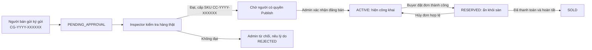
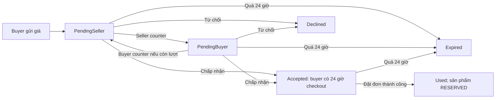

# CoCo ReTrade

ASP.NET Core MVC marketplace for inspected secondhand clothing. The solution uses .NET 10, SQL Server, ASP.NET Core Identity, EF Core, Bootstrap 5, and xUnit.

## Projects

| Project | Responsibility |
|---|---|
| `src/CoCoReTrade.Domain` | Product lifecycle and future marketplace entities |
| `src/CoCoReTrade.Application` | DTOs, service contracts, validation and product use cases |
| `src/CoCoReTrade.Infrastructure` | SQL Server, Identity, private image storage, email delivery and seeding |
| `src/CoCoReTrade.Web` | MVC, Razor views, `/Admin` and `/api/v1` |
| `tests/CoCoReTrade.Tests` | xUnit business and visibility rules |

Dependency direction: Application → Domain; Infrastructure → Application/Domain; Web → Application/Infrastructure.

## Requirements

- .NET 10 SDK (`dotnet --version`)
- Microsoft SQL Server with permission to create the `CoCoReTrade` database
- SMTP credentials for activation/reset email outside Development

This workspace also contains a local SDK at `.dotnet/dotnet.exe` (ignored by Git). Use that executable instead of `dotnet` if the SDK is not installed system wide.

## Configure

From the repository root:

```powershell
dotnet user-secrets set "ConnectionStrings:CoCo" "Server=localhost;Database=CoCoReTrade;Trusted_Connection=True;TrustServerCertificate=True" --project src/CoCoReTrade.Web
dotnet user-secrets set "Admin:InitialPassword" "<choose-a-strong-temporary-password>" --project src/CoCoReTrade.Web
dotnet user-secrets set "Shipping:StoreAddress" "<actual CoCo store address>" --project src/CoCoReTrade.Web
```

Alternatively, set `COCO_ADMIN_INITIAL_PASSWORD` as an environment variable. The app requires it **only when creating the initial admin**. Do not commit this password. Identity hashes it through `UserManager`; the admin must change it after first login.

The default admin account is `admin@cocoretrade.vn` / `0905123456`. The user is seeded on the first run after migrations. The password is never stored in source code or migration files.

An optional second admin uses the display name `admin1` and signs in with `admin1@cocoretrade.vn`. To create it in another database, set `COCO_ADMIN1_INITIAL_PASSWORD` in the app process before its first startup, then remove the variable. The seeder hashes the password through Identity, assigns User/Inspector/Admin roles, and requires a password change at first login. It never promotes an existing non-admin account with that email.

For a deployed environment, set `Storage:Root`, `Smtp:Host`, `Smtp:Port`, `Smtp:From`, `Smtp:User`, and `Smtp:Password` using environment variables or a secret manager. See `appsettings.example.json`. In Development, six-digit activation and password reset codes are shown on the confirmation page and logged. In other environments, SMTP is required. Never use the Development code display in production.

## Restore, migrate, run

To review the UI before installing SQL Server, run this in PowerShell. This Development-only mode uses six illustrated sample products and does not write data. Login, registration, listing submission and checkout require SQL Server and are disabled in this mode.

```powershell
$env:Preview__Enabled = "true"
dotnet run --project src/CoCoReTrade.Web --launch-profile http
```

Open `http://localhost:5001/preview` to browse the example screens. Remove the variable with `Remove-Item Env:Preview__Enabled` before running against SQL Server.

```powershell
dotnet restore CoCoReTrade.slnx
dotnet tool restore
dotnet tool run dotnet-ef database update --project src/CoCoReTrade.Infrastructure --startup-project src/CoCoReTrade.Web
dotnet run --project src/CoCoReTrade.Web
```

The application also applies pending migrations at startup. To create later migrations:

```powershell
dotnet tool run dotnet-ef migrations add NameOfChange --project src/CoCoReTrade.Infrastructure --startup-project src/CoCoReTrade.Web --output-dir Migrations
dotnet tool run dotnet-ef database update --project src/CoCoReTrade.Infrastructure --startup-project src/CoCoReTrade.Web
```

The migrations are checked in. SQL Server's `dbo.ProductSkuSequence` allocates unique numeric suffixes for both consignment codes (`CG-YYYY-XXXXXX`) and inventory SKUs (`CC-YYYY-XXXXXX`). A SKU is assigned only after a passed physical inspection. Both columns have unique indexes; an empty SKU is allowed only while a listing is unpublished. VND amounts use `decimal(18,0)`. Product, offer, order and wallet rows have SQL Server row-version columns.

If EF reports a connection or encryption error, first compare the `Server=` value in `ConnectionStrings:CoCo` with **Server Name** in your working SSMS connection. The design-time factory now reads Web user secrets and `ConnectionStrings__CoCo`; it does not need a password in source code. Verify the SQL Server service and local TLS/certificate settings before applying migrations. A failed connection check does not apply the new migrations.

## Luồng hoạt động của ứng dụng

Phần này mô tả **những gì code hiện tại xử lý**, theo thứ tự người dùng thao tác. Một tài khoản có thể đồng thời mua và bán; Inspector và Admin vẫn dùng được các chức năng của User. Các thao tác cần dữ liệu thật chạy với SQL Server; chế độ Preview chỉ để xem giao diện.

### Sơ đồ vòng đời chính



Việc **chấp nhận giá Offer không chuyển sản phẩm sang RESERVED**. Chỉ thao tác tạo đơn thành công mới giữ món hàng độc bản.

### 1. Mở ứng dụng, tài khoản và phân quyền

1. Trang `/Splash` hiển thị skeleton khi tải, kiểm tra phiên Identity và chuyển người đã đăng nhập tới Trang chủ, khách chưa đăng nhập tới Đăng nhập. Home và Shop vẫn có thể được mở trực tiếp để xem hàng `ACTIVE`.
2. Đăng ký bằng họ tên, email, số điện thoại duy nhất và mật khẩu hợp lệ. Hệ thống gửi **OTP 6 số qua email** để kích hoạt; mã có hiệu lực 5 phút và có luồng gửi lại. Trong Development, mã hiện trên trang xác nhận để thử nghiệm; môi trường khác cần cấu hình SMTP.
3. Đăng nhập chung bằng **email hoặc số điện thoại + mật khẩu**. Identity kiểm tra tài khoản đã kích hoạt, trạng thái khóa và chính sách điểm tín nhiệm. Quên mật khẩu: nhập email/số điện thoại → nhận OTP email → xác minh → đặt mật khẩu mới → thu hồi phiên cũ và tạo phiên đăng nhập mới. Tài khoản có thể đổi mật khẩu và đăng xuất tại Hồ sơ.
4. Vai trò `User` mua/bán; `Inspector` được xem và kiểm định hàng chờ duyệt; `Admin` quản trị đầy đủ. Quyền `Products.Publish` là quyền riêng: Admin có sẵn, Inspector chỉ có khi Admin cấp rõ ràng. Thay đổi vai trò/quyền sẽ làm phiên cũ mất hiệu lực. Admin khởi tạo từ cấu hình phải đổi mật khẩu sau lần đăng nhập đầu.
5. Tài khoản bị hạ điểm tín nhiệm dưới ngưỡng cấu hình có thể bị tạm khóa; Admin thay đổi điểm hoặc khóa tài khoản phải ghi lý do và lưu audit.

### 2. Điều hướng và khám phá sản phẩm

- Giao diện responsive có **5 mục điều hướng dưới màn hình**: Trang chủ, Khám phá, Đăng bán, Thông báo, Tôi. Mục Kiểm định/Quản trị chỉ hiển thị cho nhân viên có quyền tương ứng.
- Trang chủ hiển thị sản phẩm đang bán và danh mục nhanh. Shop cho tìm tên, thương hiệu, SKU; lọc danh mục, thương hiệu, size, khoảng giá, độ mới và hình thức nhận; sắp xếp mới nhất, giá tăng/giảm hoặc được thích nhiều.
- Thẻ và trang chi tiết hiển thị ảnh, tình trạng đã kiểm định, giá, người bán, nút thích, trả giá hoặc mua. **Truy vấn công khai và ảnh công khai chỉ trả sản phẩm `ACTIVE`**; người khác không thể mở hàng chờ duyệt hoặc bị từ chối bằng URL.
- Người dùng có thể thích/bỏ thích hàng `ACTIVE`, theo dõi người bán, xem danh sách đã lưu và tủ đồ công khai của người bán. Các thao tác giỏ hàng, trả giá và nhắn người bán được mô tả riêng ở mục 4–6.

### 3. Ký gửi và kiểm định

1. Người bán mở **Đăng bán**, nhập tên, thương hiệu, danh mục, size, giá gốc, giá mong muốn, phần trăm độ mới và bật/tắt `AllowOffers`. Tải **3–10 ảnh JPG/PNG/WebP**, tối đa 5 MB mỗi ảnh. Ảnh được kiểm tra định dạng, kích thước, số lượng và lưu ở vùng riêng.
2. Bấm gửi duyệt: hệ thống cấp **mã ký gửi** `CG-YYYY-XXXXXX` bằng SQL sequence, lưu sản phẩm `PENDING_APPROVAL` và báo nhân viên. Người bán theo dõi trong **Tủ đồ của tôi**; chưa có SKU bán hàng ở bước này.
3. Inspector tra cứu danh sách chờ bằng mã ký gửi/SKU/người bán, nhận món đồ thật, ghi kết quả đạt/không đạt, thông tin xác minh (tên, thương hiệu, loại, size, giá, độ mới), ghi chú và ảnh kiểm định tùy chọn. Inspector không được tự kiểm định bài do mình đăng. Kiểm định đạt tạo **SKU kho** `CC-YYYY-XXXXXX` duy nhất nhưng sản phẩm **vẫn chờ duyệt**. Có thể chọn ảnh bìa và in tem QR/SKU.
4. Người có `Products.Publish` kiểm tra lại và bấm **Duyệt & Đăng bán**. Chỉ bài đã kiểm định đạt và có SKU mới chuyển sang `ACTIVE`. Admin có thể **Từ chối** bài đã kiểm định với lý do bắt buộc, chuyển sang `REJECTED`. Hai kết quả đều báo người bán; kiểm định, đăng bán và từ chối đều có nhật ký audit.
5. Tủ đồ cá nhân cho người bán xem hàng chờ duyệt, bị từ chối, đang bán và đã bán. Trạng thái chờ/từ chối và ảnh liên quan chỉ mở cho chủ bài hoặc nhân viên có quyền.

### 4. Trả giá và phản đề xuất (Offer / Counter-Offer)

**Điểm bắt đầu:** Người mua đã đăng nhập mở trang chi tiết món `ACTIVE` có `AllowOffers = true`, bấm **Trả giá**. Người bán không thể trả giá món của mình. Trang tạo đề xuất cho thấy giá niêm yết và giá tối thiểu; các điều kiện được kiểm tra lại ở dịch vụ khi gửi, không dựa vào ô nhập trên trình duyệt.

1. **Buyer gửi giá lần đầu:** giá phải là số VND nguyên, thấp hơn giá niêm yết và không dưới mức `ceil(giá niêm yết × (1 − mức giảm tối đa))`. Mặc định mức giảm tối đa 25%; ví dụ món 300.000đ nhận giá từ **225.000đ đến 299.999đ**. Cấu hình mức giảm chỉ nhận 20–30%.
2. Hệ thống lưu Offer `PendingSeller`, ghi sự kiện `Submitted`, đặt hạn phản hồi sau **24 giờ** và thông báo seller. Buyer và seller theo dõi các Offer mình tham gia tại **Hồ sơ → Đề xuất giá** hoặc `/Offers`; người ngoài không xem được chi tiết.
3. **Đến lượt seller:** seller chọn **Chấp nhận** để chốt giá buyer đưa ra, **Từ chối** để kết thúc, hoặc **Đề xuất lại** một giá cao hơn giá buyer gần nhất và không vượt giá niêm yết. Nếu seller đã counter trước đó, lần counter sau phải thấp hơn giá seller trước. Counter đổi trạng thái sang `PendingBuyer`, ghi sự kiện và thông báo buyer.
4. **Đến lượt buyer sau khi seller counter:** buyer **Chấp nhận** giá seller, **Từ chối**, hoặc **đề xuất lại** giá cao hơn lần buyer trước, thấp hơn giá seller gần nhất và không dưới giá tối thiểu. Ví dụ: buyer 230.000đ → seller 260.000đ → buyer 245.000đ. Mỗi giá buyer gửi, kể cả counter, tiêu tốn **1 trong tối đa 3 lượt trên cùng sản phẩm**. Hết lượt vẫn có thể chấp nhận hoặc từ chối giá seller.
5. Mỗi lần counter đặt lại hạn phản hồi **24 giờ**; lúc một bên chấp nhận, trạng thái thành `Accepted` và giá chốt chỉ dành cho đúng buyer này trong **24 giờ tính từ lúc chấp nhận**. Chấp nhận Offer **không giữ sản phẩm**. Buyer bấm **Thanh toán** trong chi tiết Offer để đưa `offerId` vào checkout; dùng liên kết **Mua ngay** hoặc **Đặt mua** ở giỏ sẽ áp dụng giá niêm yết.
6. Dịch vụ từ chối phản hồi/checkout khi Offer quá hạn, sai lượt, sai chủ thể hoặc món không còn `ACTIVE`. Offer hết hạn thành `Expired`; Offer được dùng để tạo đơn thành `Used`. Lịch sử `OfferEvents` lưu mọi lần gửi giá, counter, chấp nhận, từ chối, hết hạn và dùng để đặt đơn. Bên kia nhận thông báo trong app sau mỗi phản hồi.



### 5. Giỏ hàng (Cart)

1. Buyer đã đăng nhập mở món `ACTIVE` không thuộc mình, bấm **Thêm vào giỏ** ở trang chi tiết. Hệ thống kiểm tra lại trạng thái và chủ hàng. Cùng một món chỉ xuất hiện **một lần** trong giỏ của tài khoản; tối đa **20 món**.
2. Mở biểu tượng **Giỏ hàng** trên header hoặc `/Cart` để xem ảnh, SKU, tên, size, tình trạng và **giá niêm yết hiện tại**. Tại đây buyer có thể **Bỏ khỏi giỏ** hoặc **Đặt mua** từng món. Thêm giỏ không tạo đơn, không khóa hàng và không đảm bảo món vẫn còn khi quay lại.
3. Bấm **Đặt mua** chuyển đến checkout của **một món**; backend tính lại giá và phí. Nếu món đã bị giữ/bán hoặc ngừng `ACTIVE`, giỏ sẽ loại món không còn mở bán khi tải lại. Một món có thể bị người khác mua trước lúc buyer xác nhận đơn; checkout xử lý tranh chấp này bằng transaction và ràng buộc dữ liệu.
4. **Chưa có checkout nhiều món trong một lần**, chưa có số lượng cho sản phẩm độc bản và giỏ không tự áp dụng giá Offer. Để mua theo giá thương lượng, buyer phải mở Offer `Accepted` của mình rồi vào checkout từ đó.

### 6. Nhắn người bán (Messages)

1. Buyer đã đăng nhập mở chi tiết món `ACTIVE` của người khác, bấm **Nhắn người bán**. Hệ thống tìm hội thoại theo **cặp sản phẩm + buyer**; nếu chưa có thì tạo một hội thoại riêng với seller, nếu đã có thì mở lại hội thoại đó. Bấm nút chỉ **mở hội thoại trống**, chưa tự gửi lời nhắn.
2. Buyer nhập nội dung và bấm **Gửi tin nhắn**. Seller mở biểu tượng **Tin nhắn** trên header hoặc mục Tin nhắn trong Hồ sơ để xem danh sách và trả lời. Hai bên có thể tiếp tục nói chuyện trong hội thoại đã tạo, kể cả sau khi sản phẩm không còn mở bán.
3. Nội dung sau khi cắt khoảng trắng phải dài **1–1.000 ký tự**; cùng một người cần chờ ít nhất **3 giây** giữa hai tin liên tiếp. Mỗi tin được lưu SQL Server, cập nhật thời gian hoạt động của hội thoại và tạo thông báo cho người còn lại. Danh sách hiện tối đa 100 hội thoại gần nhất; trang chi tiết hiện 200 tin gần nhất và đánh dấu tin nhận đã đọc.
4. Chỉ đúng buyer và seller của hội thoại được xem/gửi; người khác không thể đọc bằng URL/API hoặc tự tham gia nhóm SignalR. Sau khi SQL transaction lưu tin thành công, SignalR đẩy tin tới hai trình duyệt đang mở hội thoại. JavaScript gửi tin qua API có anti-forgery, thêm tin mới ngay vào trang và lọc trùng theo mã tin. Khi kết nối lại, trình duyệt tải tin từ SQL Server để bù tin đã bỏ lỡ; nếu JavaScript không chạy, form POST thông thường vẫn gửi được.
5. SignalR hiện cập nhật **trang chi tiết hội thoại** theo thời gian thực; danh sách hội thoại và biểu tượng thông báo chưa cập nhật tức thời. Tin vẫn được lưu và thông báo trong app cho người không mở trang chat. Chưa có SMS; nút trả giá là luồng riêng, không tự tạo Offer từ nội dung chat. Bản cài đặt một web server không cần dịch vụ SignalR ngoài; triển khai nhiều server cần cấu hình scale-out như Redis backplane hoặc Azure SignalR Service.

### 7. Checkout, giao nhận và đơn hàng

1. Buyer chọn **Mua ngay** ở giá niêm yết hoặc thanh toán bằng **Offer của chính mình đã được chấp nhận và còn hạn**. Không thể mua món của mình, món chưa đăng bán hay món đã giữ/bán. Backend tính báo giá; client không được quyết định giá, phí hoặc chủ hàng.
2. Chọn **Tới CoCo lấy**: nhập tên, số di động Việt Nam và lịch lấy trong **1–3 ngày tới**, trong giờ mở cửa cấu hình (mặc định 09:00–21:00). Phí nhận tại cửa hàng **0đ**; chức năng chỉ mở khi cấu hình địa chỉ cửa hàng thật.
3. Chọn **Giao tận nơi**: nhập tên, số điện thoại, **tỉnh/thành phố + phường/xã + địa chỉ cụ thể**, chọn khung giao và ghi chú nếu cần; có thể chọn địa chỉ đã lưu. Ứng dụng không dựa vào danh sách quận/huyện cũ. Bảng `ShippingZones` xác định cặp tỉnh/phường nội thành: phí **20.000đ**; địa chỉ hợp lệ khác **35.000đ**. Phí hiển thị khi chọn đủ vùng.
4. Màn checkout hiển thị **tiền hàng + phí vận chuyển = tổng thanh toán** theo kết quả backend. Nếu chưa chọn đủ địa chỉ giao, phí còn chờ tính. Hoa hồng CoCo mặc định **15%**, được cấu hình trong khoảng **15–20%**, tính trên **giá hàng cuối cùng**, không tính phí ship.
5. Xác nhận: transaction SQL tạo một đơn `PENDING_PROCESSING`, trạng thái thanh toán `UNPAID`, rồi chuyển sản phẩm `ACTIVE → RESERVED`. Đơn lưu snapshot bất biến của món hàng, giá chốt, hoa hồng, phí ship, người nhận, địa chỉ hoặc lịch lấy. Row-version, ràng buộc một đơn còn hiệu lực cho một món và khóa idempotency chống mua trùng/gửi lại. Admin, seller và buyer được báo. Người bán xem đơn mà không thấy địa chỉ/liên hệ riêng của buyer.

### 8. Xử lý, hủy và hoàn tất đơn

- Buyer xem lịch sử/trạng thái đơn. Buyer chỉ được hủy đơn **chưa thanh toán và còn `PENDING_PROCESSING`**; Admin có thể hủy thêm đơn pickup `READY_FOR_PICKUP` chưa thanh toán. Hủy hợp lệ chuyển đơn sang `CANCELLED`, trả sản phẩm `RESERVED → ACTIVE` và thông báo các bên.
- Admin xem hàng đợi đơn, đánh dấu **sẵn sàng nhận tại cửa hàng** hoặc **đang giao**, xác nhận khoản thanh toán thực tế bằng mã tham chiếu, rồi hoàn tất. Chỉ đơn đã xác nhận **`PAID`** và ở trạng thái giao/nhận phù hợp mới được hoàn tất; khi đó đơn `COMPLETED`, sản phẩm `SOLD`.
- Worker hết hạn tự hủy và mở bán lại **đơn vẫn chưa thanh toán, vẫn chờ xử lý** quá `Orders:UnpaidReservationMinutes` (mặc định 1440 phút). Tạo đơn hoặc đánh dấu đang giao **không đồng nghĩa đã nhận tiền**.

### 9. Ví ký gửi và rút tiền

1. Sau khi đơn **đã thanh toán và hoàn tất**, Admin xác nhận đối soát. Dịch vụ ghi có **một lần** vào ví seller: `giá hàng chốt − hoa hồng CoCo`; tiền ship không tham gia phép tính. Có sổ giao dịch/audit để truy vết. Đặt đơn đơn thuần không ghi có ví.
2. Seller xem số dư khả dụng, tiền chờ xử lý/rút và lịch sử giao dịch; gửi yêu cầu rút tiền trong giới hạn số dư khả dụng với mã yêu cầu chống gửi lặp và thông tin tài khoản ngân hàng đã che.
3. Admin **duyệt hoặc từ chối** yêu cầu; từ chối hoàn số dư đã giữ về khả dụng. Trạng thái duyệt là **quyết định nội bộ**, không xác nhận ngân hàng đã chuyển tiền. Chưa có tích hợp chuyển khoản thật.

### 10. Thông báo, hồ sơ, hỗ trợ và quản trị

- Hộp thông báo trong app chia **Giao dịch & Offer / Sản phẩm / Tương tác & hệ thống**, hỗ trợ đánh dấu đã đọc. Các sự kiện ký gửi, kiểm định, đơn, trả giá, tin nhắn, ví và hỗ trợ tạo thông báo phù hợp. Thông báo và outbox email/web push được lưu transaction; worker thử gửi lại theo lịch. Email chỉ gửi được khi cấu hình SMTP; chưa có provider web push thật.
- Hồ sơ cho đổi ảnh đại diện, xem điểm tín nhiệm, tủ đồ, Offer, đơn mua/bán, hàng đã lưu, địa chỉ, ví, thông báo, tin nhắn, giỏ hàng, đổi mật khẩu, trợ giúp và đăng xuất. Trang điều khoản hiện là nội dung vận hành; văn bản pháp lý chính thức cần được phê duyệt riêng.
- Người dùng tạo ticket hỗ trợ và trả lời ticket của mình. Admin có quyền quản lý người dùng xem hàng đợi, trả lời và đóng ticket; phản hồi gửi thông báo, thao tác quản trị ghi audit.
- Khu `/Admin` có dashboard, danh sách ký gửi, kiểm định, quản lý sản phẩm/đơn/ví/người dùng, phân quyền Inspector và `Products.Publish`, điểm tín nhiệm, hộp hỗ trợ và lịch sử audit. Chính sách quyền được kiểm tra ở MVC/API **và dịch vụ**, không chỉ ẩn nút giao diện. Nhân viên không tự động đăng bán khi kiểm định đạt.

### 11. Dịch vụ nền và giới hạn tích hợp

| Dịch vụ | Công việc hiện tại |
|---|---|
| ProductCode/Lifecycle | Cấp mã bằng SQL sequence, kiểm tra chuyển trạng thái hợp lệ, giữ/bán/mở lại hàng |
| OfferExpirationWorker | Hết hạn Offer cũ khoảng mỗi phút |
| OrderExpirationWorker | Hủy đơn chưa thanh toán còn chờ quá thời hạn khoảng mỗi phút |
| ListingReminderWorker | Nhắc người bán một lần khi bài `ACTIVE` cũ quá `Listings:ReminderAfterDays` (mặc định 30 ngày); không tự hạ giá |
| OutboxDispatcherWorker | Xử lý hàng đợi email/web push khoảng mỗi 15 giây; có retry, gửi có thể lặp nên provider phải chống trùng |

Mọi mốc thời gian được lưu UTC. Các thay đổi quan trọng dùng transaction và row-version. **Không worker nào tự đăng bán sản phẩm.** Hiện chưa có địa chỉ cửa hàng thật, tài khoản dịch vụ SMS OTP, Google/Apple, web push, cổng thanh toán hay chuyển khoản ngân hàng. Cấu hình SMTP là điều kiện để OTP email chạy ngoài Development. Những tích hợp này không được xem là đã hoàn thành chỉ vì đã có màn hình, trạng thái hoặc thông báo nội bộ.

### Cấu hình liên quan đến các luồng

- `Marketplace:MaximumOfferDiscountPercent` mặc định `25`, chỉ nhận `20–30`; `Marketplace:CommissionPercent` mặc định `15`, chỉ nhận `15–20`. Cấu hình ngoài khoảng hợp lệ sẽ khiến ứng dụng không khởi động.
- `Shipping:InnerCityZones` chứa **cặp tỉnh/thành và phường/xã hiện hành**, ví dụ `[{ "Province": "<tỉnh/thành>", "Ward": "<phường/xã>" }]`. Dữ liệu này chỉ được seed vào bảng `ShippingZones` khi bảng trống. Sau đó quản lý các cột `Province`, `Ward`, `IsInnerCity`, `IsActive` trong SQL Server. Không tự suy đoán quận/huyện cũ là phường/xã mới.
- Pickup cần `Shipping:StoreAddress` thật. `Shipping:StoreUtcOffsetHours`, `Shipping:OpeningHour`, `Shipping:ClosingHour` điều khiển lịch lấy; `Shipping:StoreMapUrl` là liên kết bản đồ HTTPS tùy chọn. `Orders:UnpaidReservationMinutes` mặc định `1440` (cho phép `15–10080`); `Listings:ReminderAfterDays` mặc định `30` (cho phép `7–365`).
- Nếu nâng cấp database đã có dữ liệu, hãy sao lưu trước khi áp dụng migrations. `InspectorWorkflow` chuyển SKU cũ của bài ký gửi thành mã ký gửi; `CheckoutOrders` giữ địa chỉ cũ trong `StreetAddress` và không tự biến quận/huyện thành phường/xã. Các migration tiếp theo gồm `SystemServices`, `ExperienceCompletion`, `ShoppingCart`, `MessagingAndCoverVersion` và `CustomerSupport`.
- Chat thời gian thực dùng JavaScript client `@microsoft/signalr` 10.0.0 lưu tại `src/CoCoReTrade.Web/wwwroot/lib/signalr` cùng giấy phép MIT. Hub chạy tại `/hubs/conversations`; không cần migration mới hay npm khi chạy ứng dụng.

## Versioned API

- `GET /api/v1/products` and `GET /api/v1/products/{id}` — public, active products only
- `GET /api/v1/listings/mine`, `POST /api/v1/listings` — authenticated user
- `GET /api/v1/admin/inspections/pending`, `GET /api/v1/admin/inspections/{id}` — Inspector or Admin
- `POST /api/v1/admin/inspections/{id}` (multipart form with row version and optional images) — Inspector or Admin
- `POST /api/v1/admin/inspections/{id}/publish` — explicit `Products.Publish` permission; `POST .../{id}/reject` — Admin
- `GET /api/v1/admin/products`, `/dashboard`, `/audit`; `GET /api/v1/admin/users`, `POST .../inspector`, `/publish-grant`, `/lock`; `GET /api/v1/admin/wallets` — permission gated
- `POST /api/v1/products/{productId}/offers` — submit a price (`{ "price": 230000 }`)
- `GET /api/v1/offers`, `GET /api/v1/offers/{id}` — participant offer history
- `POST /api/v1/offers/{id}/accept`, `/decline`, `/counter` — receiving party; counter body is `{ "price": 250000 }`
- `GET /api/v1/orders/quote?productId=...&offerId=...&fulfillment=Shipping&province=...&ward=...` — server-calculated quote; omit `offerId` for Buy Now
- `POST /api/v1/orders` — place order with `productId`, optional `offerId`, required `idempotencyKey` UUID, recipient, fulfillment, and pickup local time (`yyyy-MM-ddTHH:mm`) or province/ward/street address
- `GET /api/v1/orders`, `GET /api/v1/orders/{id}`, `POST /api/v1/orders/{id}/cancel` — buyer/seller history and permitted cancellation
- `GET /api/v1/admin/orders`, `GET /api/v1/admin/orders/{id}`, `POST .../{id}/ready`, `/confirm-payment`, `/complete`, `/cancel` — Admin only
- `GET /api/v1/notifications` — the current user's notifications
- `GET /api/v1/notifications?group=transactions|listings|social`, `POST /api/v1/notifications/{id}/read` — grouped inbox and read action
- `GET /api/v1/social/favorites`, `PUT`/`DELETE /api/v1/social/favorites/{productId}`, `GET /api/v1/social/following`, `PUT`/`DELETE /api/v1/social/following/{sellerId}` — saved items and seller follows
- `GET /api/v1/cart`, `PUT`/`DELETE /api/v1/cart/items/{productId}` — current user's cart, active products only
- `GET /api/v1/messages`, `POST /api/v1/messages/products/{productId}`, `GET /api/v1/messages/{id}`, `POST /api/v1/messages/{id}/messages` — participant-only conversations
- `GET`/`POST /api/v1/support`, `GET /api/v1/support/{id}`, `POST /api/v1/support/{id}/replies`; Admin queue, reply and close actions live under `/api/v1/admin/support`
- `GET /api/v1/addresses`, `POST /api/v1/addresses`, `DELETE /api/v1/addresses/{id}` — current user's address book
- `GET /api/v1/wallet`, `POST /api/v1/wallet/withdrawals` — available/pending balance and idempotent withdrawal request (`requestKey`, `amount`, `bankAccountMasked`)
- `GET /api/v1/admin/wallets/withdrawals`, `POST /api/v1/admin/wallets/withdrawals/{id}/approve` or `/reject` — permission-gated decisions; rejection body is `{ "reason": "..." }`

For cookie-authenticated `POST`, `PUT`, `PATCH` and `DELETE` requests, first call `GET /api/v1/session/antiforgery`, retain the cookie and send the returned token in the `X-CSRF-TOKEN` header. MVC forms include anti-forgery tokens automatically.

## Tests

```powershell
dotnet test CoCoReTrade.slnx
```

The existing tests cover minimum photo count, publishing state transitions, privacy of pending listings/photos, offer authorization and expiry, Buy Now and negotiated prices, shipping zones, validation, idempotency, concurrent buyers, cancellation/restocking and paid completion. The new profile, cart, messaging and support flows still need dedicated automated tests. A live SQL Server is required to exercise the database migrations and full application; the existing unit tests do not require one.
